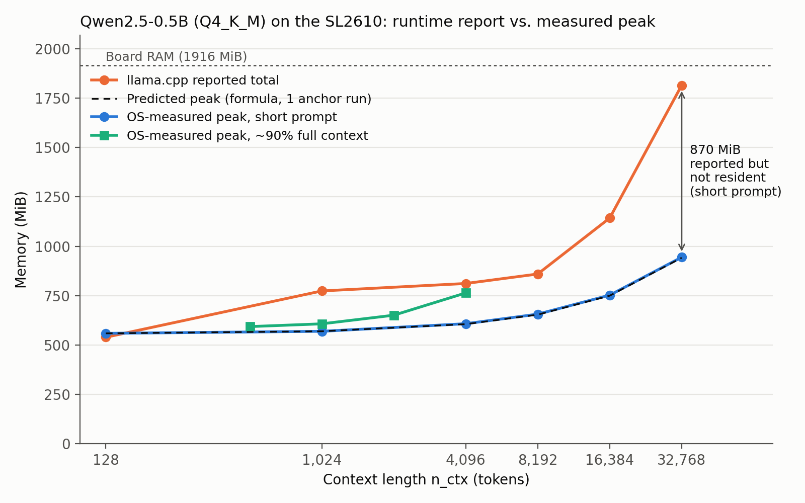

# Where the memory goes: LLM inference on a 2 GB edge board

Independent project, Suraj Sedai, Mercy University, November 2026.

This applies the method from my preprint *Measuring the Wrong Ledger: Pitfalls and a Memory Model for KV Cache Studies* ([doi.org/10.5281/zenodo.23642746](https://doi.org/10.5281/zenodo.23642746)) to a different model on a different class of hardware. The method: predict peak memory from the tensors that are live at the peak, then measure it at the OS level, and keep what the model needs separate from what the runtime adds.



## Headline results

All results are for Qwen2.5-0.5B-Instruct (Q4_K_M, llama.cpp on the CPU) on a Synaptics SL2610 board (2x Cortex-A55, 2 GB RAM). Full tables are in [`results.md`](results.md).

1. **KV cache: exact.** The closed-form cache term (2 x layers x KV heads x head_dim x bytes x tokens, in its grouped-query form) matches the runtime's allocation with 0.00% error from 128 to 32,768 tokens.
2. **Peak memory: within 0.4%, from one anchor run.** Taking the OS-measured peak (VmHWM) at n_ctx = 128 and adding the formula's extra KV bytes predicts the measured peak within 0.4% across a 256x range of context lengths. There are no fitted parameters. This holds for short prompts.
3. **The runtime's own memory report is the wrong ledger.** llama.cpp reports 1,815 MiB at n_ctx = 32,768. The OS measures 945 MiB. The 870 MiB gap is a compute buffer reserved for the worst case and never touched with a short prompt. The reservation follows a closed form: max(n_ubatch x vocab x 4 B, attention scores + mask). That form matches within 7.5 MiB at default settings, and the regime switches from output scores to attention scores at about vocab / heads = 10,850 tokens. Nearly all the output-score term is space for vocabulary scores at *every* position in a micro-batch, when only the last position is needed. That's the same effect behind the measurement defect in my paper, here inside the runtime's reservation.
4. **In a full context, the attention matrix is actually used, and flash attention trades it for speed.** At 90% fill, the extra memory touched grows with context, from 29 MiB at 512 to 156 MiB at 4,096. At 4,096, turning on flash attention removes 113 MiB, about one f32 attention-score matrix plus its mask (105 MiB). About 43 MiB of the extra stays unexplained. My pre-run prediction for the flash-attention run (10–20 MiB extra) missed. The same switch costs 19% in prefill speed and 23% in decode speed on this CPU: a measured memory-for-compute trade-off.
5. **Capacity is not the limit; bandwidth is close to it.** At a 4,096 context the process uses 764 of 1,916 MiB, yet decode has slowed 31%. Every decoded token reads all 463 MiB of weights. Measured copy bandwidth is 3.0–3.2 GB/s, which caps decode at 6.1–6.6 tok/s; two cores reach 5.4 tok/s, about 81–88% of that ceiling. One core reaches only 3.0 tok/s, so decode is compute-bound on one core and approaches the bandwidth limit on two. Prefill scales 1.92x with cores and is compute-bound.

## Limitations

- One board, one model, one runtime (llama-cpp-python 0.3.16), CPU only. The NPU route was blocked by a runtime/model bytecode version mismatch (runtime 16.0, model files 15.0).
- Results 2 and 3 are for short prompts. In a full context, part of the reserved compute buffer is touched (result 4). The 870 MiB is reserved, not unused under every workload.
- The bandwidth ceiling comes from a numpy copy loop, which counts reads and writes. Read-only bandwidth may be higher, which would make the decode fraction lower.
- About 43 MiB of memory touched in a full context at n_ctx = 4,096 is unexplained, with flash attention on or off. With flash attention at n_ctx = 16,384 and a short prompt, the reserved buffer was 32 MiB above the closed form; that is also unexplained. The flash-attention full-context result is a single run.
- Repeats agree within 0.05 MiB and 0.03 tok/s, so variance is negligible. That reflects a quiet, single-user board, not a general claim.

## Disclosure

The measurements, predictions and interpretation are mine. The sweep and analysis scripts were written with help from Claude (Anthropic).

## Reproduce

Board setup (Poky 5.0.9, Astra SDK ≤ v2.5.0; the board has no internet, so wheels are pushed from the host over ADB) is summarised in the limitations above; the commands below assume the model and `sweep_ctx.py` are in `/home/root`.

```bash
adb push sweep_ctx.py /home/root/
adb shell
cd /home/root
# short prompt, allocation sweep (~6 min)
python3 sweep_ctx.py --model qwen2.5-0.5b-instruct-q4_k_m.gguf --ctx 128 1024 4096 8192 16384 32768 --prompt-tokens 64 --repeats 3 --out alloc.csv
# ~90% full context (~45 min)
python3 sweep_ctx.py --model qwen2.5-0.5b-instruct-q4_k_m.gguf --ctx 512 1024 2048 4096 --fill 0.9 --repeats 3 --out fill.csv
# variants
python3 sweep_ctx.py ... --flash-attn --out fa.csv
python3 sweep_ctx.py ... --n-ubatch 128 --n-batch 128 --out ub128.csv
python3 sweep_ctx.py ... --threads 1 --out threads1.csv
python3 sweep_ctx.py --model qwen2.5-0.5b-instruct-q4_k_m.gguf --ctx 4096 --fill 0.9 --repeats 1 --flash-attn --out fill_fa.csv
```

Copy the CSVs into `data/` and run `python3 analyze.py` on the host. It regenerates `results.md` and the figure. Each run is a fresh process, because VmHWM is a per-process high-water mark. Raw llama.cpp logs for every run are kept in `data/*_logs/`.

## Files

| File | What it is |
|---|---|
| `sweep_ctx.py` | Runs on the board: one process per configuration; logs runtime buffers, RSS split into anonymous and file-backed memory, VmHWM, and tok/s |
| `analyze.py` | Runs on the host: CSVs to tables and figure |
| `data/` | Raw CSVs and llama.cpp logs |
| `results.md` | All tables |
| `figures/memory_ledger.png` | Headline figure |
